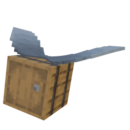

# Do a Barrel Roll (Bedrock)

A port of [Do a Barrel Roll](https://codeberg.org/enjarai/do-a-barrel-roll) by enjarai to Minecraft Bedrock Edition, as a [LeviLamina](https://github.com/LiteLDev/LeviLamina) client mod. It adds full pitch, yaw and roll to elytra flight.

## Compatibility

| Component                     | Version          |
| ----------------------------- | ---------------- |
| Minecraft Bedrock for Windows | 1.26.51.01       |
| LeviLamina                    | 26.51.6 (client) |

## Installation

With [lip](https://github.com/LiteLDev/lip), from the game directory:

```
lip install github.com/theaddonn/Do-A-Barrel-Roll-Bedrock#client
```

Or download `Do-A-Barrel-Roll-Bedrock-client-windows-x64.zip` from the [releases](https://github.com/theaddonn/Do-A-Barrel-Roll-Bedrock/releases) and extract the `DoABarrelRoll` folder into `mods/`.

## Features

- Full pitch, yaw and roll while gliding, with smoothing, banking, automatic righting and momentum-based mouse.
- Camera roll and player model roll.
- Optional artificial horizon and momentum widget HUD.
- Optional thrust with smoke particles.
- Keyboard, mouse and controller support.

## Controls

Keys are listed in the controls screen under the mod's name.

| Action                                                     | Default |
| ---------------------------------------------------------- | ------- |
| Toggle mod                                                 | I       |
| Yaw left / right                                           | A / D   |
| Thrust forward                                             | W       |
| Toggle thrust, pitch up/down, roll left/right, thrust back | unbound |

Controller (XInput):

| Input      | Action                |
| ---------- | --------------------- |
| Right stick | Roll and pitch       |
| LB / RB    | Yaw left / right      |
| RT / LT    | Thrust forward / back |

## Configuration

The config is written on first start to `mods/DoABarrelRoll/config/config.json`, using the same layout as the Java mod. Main options:

| Option                                  | Default |
| --------------------------------------- | ------- |
| `general.mod_enabled`                   | `true`  |
| `general.controls.activation_behaviour` | `VANILLA` (or `TRIPLE_JUMP`, `HYBRID`, `HYBRID_TOGGLE`) |
| `general.controls.switch_roll_and_yaw`  | `false` |
| `general.controls.invert_pitch`         | `false` |
| `general.controls.momentum_based_mouse` | `false` |
| `general.controls.disable_when_submerged` | `true` |
| `general.hud.show_horizon`              | `false` |
| `general.banking.enable_banking`        | `true`  |
| `general.banking.banking_strength`      | `20.0`  |
| `general.banking.automatic_righting`    | `false` |
| `general.thrust.enable_thrust`          | `false` |
| `general.thrust.max_thrust`             | `2.0`   |
| `general.thrust.thrust_acceleration`    | `0.1`   |
| `general.thrust.thrust_particles`       | `true`  |
| `general.misc.enable_gamepad`           | `true`  |
| `general.misc.gamepad_deadzone`         | `0.15`  |
| `general.misc.thrust_allow_remote`      | `false` |
| `sensitivity.desktop` / `.controller`   | pitch 1.0, yaw 0.4, roll 1.0 |
| `sensitivity.camera_smoothing`          | pitch 1.0, yaw 2.5, roll 1.0 |

## Thrust limitation

Bedrock movement is server-authoritative. Thrust only works in singleplayer, in worlds you host, or on servers running the server mod with `allowThrusting`, where the server accepts the client's position. On other remote servers thrust is disabled. Setting `general.misc.thrust_allow_remote` forces it on, which causes rubber-banding.

## Server mod

A second build of the same project runs on Bedrock Dedicated Server with LeviLamina 26.51.6 (server). It is optional; clients without it are unaffected, and the client mod works on vanilla servers as before.

With the server mod and the client mod, players get:

- Thrust on remote servers, if the server allows it. The server accepts the thrusting client's position instead of rubber-banding it.
- Other players see your roll.
- Server-controlled config: thrust can be allowed, the mod can be forced on, and players can be kicked if they lack the mod.

Install with lip: `lip install github.com/theaddonn/Do-A-Barrel-Roll-Bedrock#server`, or extract `Do-A-Barrel-Roll-Bedrock-server-windows-x64.zip` into the server directory so that `plugins/DoABarrelRoll` exists. The config is `plugins/DoABarrelRoll/config/config.json`:

| Option             | Default | Meaning                                                              |
| ------------------ | ------- | -------------------------------------------------------------------- |
| `allowThrusting`   | `false` | Allow clients to use thrust                                          |
| `forceEnabled`     | `false` | Force the mod on for clients                                         |
| `forceInstalled`   | `false` | Kick players that do not complete the handshake                      |
| `installedTimeout` | `400`   | Ticks after joining to wait for the handshake before kicking (`forceInstalled`) |
| `maxThrustSpeed`   | `8.0`   | Largest velocity in blocks per tick accepted from a thrusting client, `0` for unlimited |

Operators ignore `forceEnabled` and may always thrust. Clients detect the server mod through its `/doabarrelroll` command and then talk over LeviLamina runtime packets, so vanilla servers never receive a custom packet.

## Not ported

- In-game config screen (edit the JSON file).
- In-game editing of the server config.

## Building

Requires [xmake](https://xmake.io). On Windows:

```
xmake f -y -p windows -a x64 -m release
xmake
```

Pass `--target_type=client` (default) or `--target_type=server` to `xmake f` to pick the variant. The built mod is in `bin/DoABarrelRoll`.

## License

GPL-3.0, like the original mod. Credit for Do a Barrel Roll goes to [enjarai](https://codeberg.org/enjarai); the icon is by Mizeno, from the original mod.
